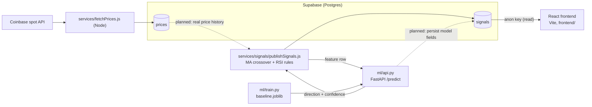

# TrendPulse

> Crypto market signals dashboard: rule-based buy/sell signals on technical
> indicators, reviewed by an ML model that predicts short-term price direction.

> **Note:** This is the open, demo version of TrendPulse. Without Supabase
> credentials it shows a clear "not connected" state (or bundled sample data,
> see below). The production app with live signals is private.

## Features

- **Signals dashboard**: React UI with a pair selector, signal cards
  (BUY / SELL / HOLD, price, % change, rule confidence) and loading / error /
  empty states.
- **Price chart**: Recharts line chart per pair (currently on mock prices).
- **Supabase data layer**: `prices` and `signals` tables
  (`supabase/migrations/0001_init.sql`); the frontend reads `signals` with the
  anon key.
- **Live price fetch**: `services/fetchPrices.js` pulls the BTC-USD spot price
  from Coinbase and stores it in Supabase.
- **Indicators + signal rules**: simple moving average and Wilder's RSI
  (`services/indicators/`), MA-crossover and RSI-threshold rules
  (`services/signals/`), published to the `signals` table.
- **ML price-direction model**: Python pipeline (`ml/`) for cleaning, feature
  engineering, a logistic-regression baseline, evaluation against a
  majority-class benchmark, and a FastAPI `/predict` endpoint.
- **Model filter**: the model confirms, vetoes or leaves each rule signal
  alone. It never creates a trade, and if the API is down signals pass
  through unchanged.
- **Prediction badge**: each signal card shows the model's direction,
  confidence and verdict.

Honest status: the baseline model does not beat the majority-class benchmark
yet (see `ml/README.md`). It is there to prove the plumbing, not an edge.

## Tech stack

React 19 + Vite, React Router, Recharts, Tailwind CSS · Supabase (Postgres,
supabase-js) · Node.js services · Python (pandas, scikit-learn, FastAPI,
uvicorn) · Netlify (frontend hosting)

## Architecture



- **Frontend** (`frontend/`): Vite + React app. `useSignals` reads the
  `signals` table; the chart uses mock prices for now.
- **Services** (`services/`): Node scripts that hold the service-role key.
  `fetchPrices.js` writes prices; `publishSignals.js` runs the rules,
  optionally asks the ML API to confirm or veto each signal, and inserts rows.
- **ML** (`ml/`): offline training + evaluation, plus the FastAPI prediction
  server the services call.
- **Planned**: rules reading real history from `prices` (they use the mock
  series today), persisting model fields on `signals`, and the
  `supabase/functions/fetch-market-data` edge function (currently a stub).

## Getting started

Requirements: Node.js 20+, Python 3.11+, and optionally a Supabase project.

### Frontend

```
cd frontend
npm install
npm run dev       # http://localhost:5173
npm run build     # production build into frontend/dist
npm run lint      # oxlint
```

To connect live data, create `frontend/.env` with `VITE_SUPABASE_URL` and
`VITE_SUPABASE_ANON_KEY` (see `.env.example`). Without them the signals view
shows "not connected"; set `USE_SAMPLE_DATA = true` in
`frontend/src/hooks/useSignals.js` to render the bundled sample signals.

### Database

Run `supabase/migrations/0001_init.sql` in your Supabase project (SQL editor
or `supabase db push`).

### Services (Node)

```
npm install                                   # from the repo root
cp .env.example .env                          # fill SUPABASE_URL + SUPABASE_SERVICE_ROLE_KEY
node services/fetchPrices.js                  # store one BTC-USD spot price
node services/signals/publishSignals.js       # dry run without env, inserts with it
```

Set `ML_API_URL=http://127.0.0.1:8000` to have the model filter signals.

### ML pipeline (Python)

```
pip install -r ml/requirements.txt
python ml/features.py --infile ml/data/bitcoin_usd_historical.csv
python ml/train.py
python ml/evaluate.py
uvicorn ml.api:app --reload                   # POST /predict on :8000
```

`ml/data/` is gitignored, so bring your own `*_historical.csv`
(date, price, total_volume). See `ml/README.md` for details.

### Checks

The JS modules ship small self-check scripts (no framework needed):

```
node services/indicators/rsi.test.js
node services/indicators/movingAverage.test.js
node services/signals/maCrossover.test.js
python ml/features_check.py
```

### Deploy

`netlify.toml` builds `frontend/` and publishes `frontend/dist` with an SPA
fallback for client-side routes.

## Roadmap

- [x] Frontend scaffold — Vite + React, routing, landing page
- [x] Layout, navigation, and core UI components
- [x] Signals list and price chart (mock data)
- [x] Theme and styling
- [x] Supabase project + schema (prices, signals)
- [x] Fetch live market data and store it
- [x] Wire frontend to real Supabase data
- [x] Indicators: moving average, RSI
- [x] Signal rules (e.g. MA crossover)
- [x] Python ML pipeline — data pull, cleaning, features
- [x] Baseline model (price direction up/down) + evaluation
- [x] Prediction endpoint and integration into signal flow
- [x] Show predictions + confidence in the UI
- [ ] Deploy to Netlify + live demo link
- [ ] Screenshots / GIF in README
- [x] Full README (features, architecture, run steps)
- [ ] Tests for one module
- [ ] Launch polish (pin repo, profile README, blurb)

## Status

🚧 In active development. Follow along — commits land daily.

## License

[MIT](LICENSE) © Edin Peci
